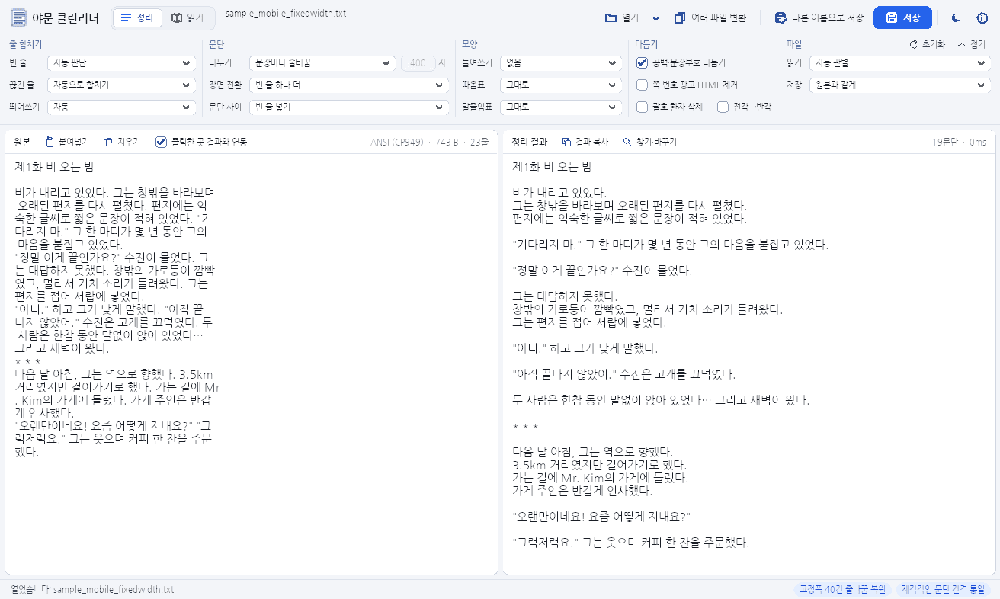
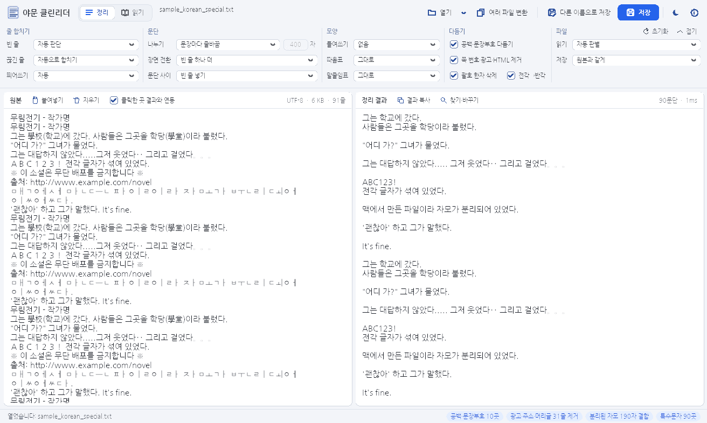
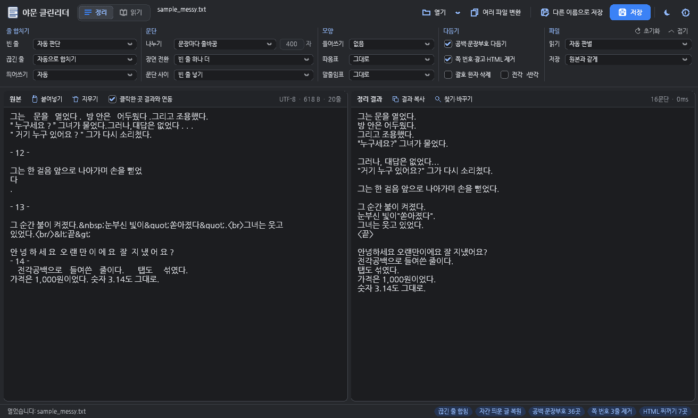
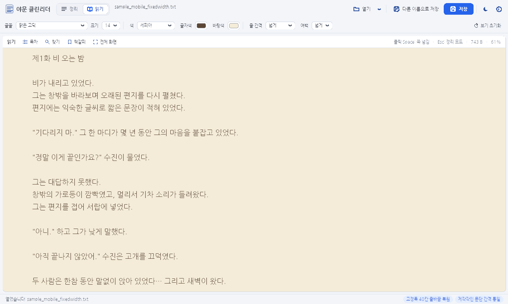
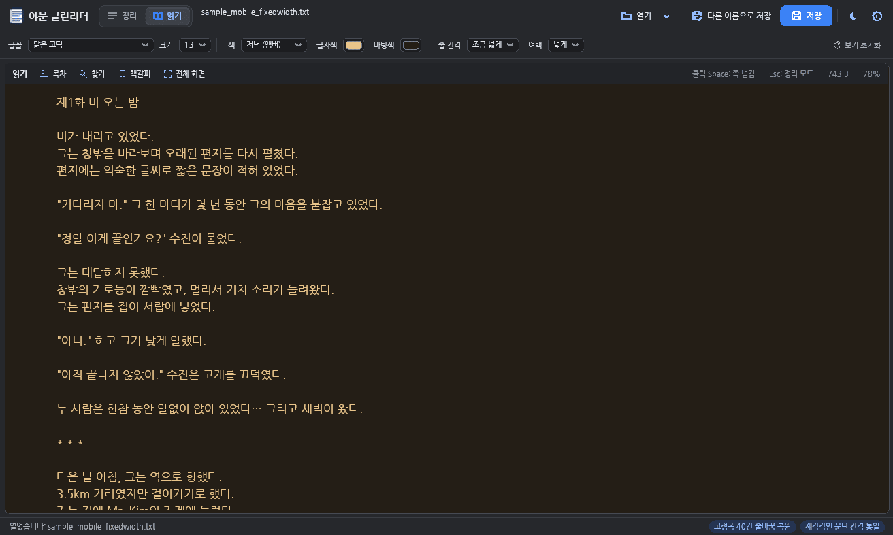

# 야문 클린리더

**망가진 TXT를, 읽을 수 있는 책으로.**

옛 모바일 txt, 한 줄로 뭉친 글, 웹에서 긁어 온 찌꺼기투성이 글을 
문장 · 대사 · 장면 단위로 분석해 원래의 문단으로 되살리고, 그대로 책처럼 읽게 해 주는 Windows 프로그램

옛 모바일용 <b>40칸 고정폭</b> CP949 글 — 잘린 폭을 스스로 찾아내 문장을 잇고, 대사와 장면 전환(* * *)을 살려 문단으로 복원

---

## 왜 클린리더인가

줄바꿈을 지우는 도구는 많습니다. 하지만 그런 도구는 **대사를 문단에 뭉개고, 시를 한 줄로 이어 붙이고, 장 제목을 본문에 섞어 버립니다.**

클린리더는 규칙 몇 개를 기계적으로 적용하지 않습니다. 글을 열면 **먼저 글 전체를 읽고 그 글의 줄바꿈 습관부터 판별**한 다음, 그 글에 맞는 방식으로 정리합니다.

| 글의 형태 | 클린리더가 하는 일 |
|---|---|
| 빈 줄로 문단을 나눈 글 | 빈 줄을 문단 경계로 보고, 문장 중간에서 끊긴 줄(조사 · 연결 어미로 끝난 줄)만 골라 합침 |
| 옛 모바일처럼 **일정 폭으로 잘린 글** | 잘린 폭을 통계로 찾아내, 꽉 찬 줄은 잇고 짧게 끝난 줄 · 들여쓴 줄에서 문단을 나눔 |
| **한 줄로 이어진 글** | 문장 단위로 나누고, 글 속에 파묻힌 회차 제목(`… 끝났다. 제2화 만남 아침이 …`)을 찾아 제목과 본문을 분리 |
| 줄마다 빈 줄이 낀 글 · 간격이 제각각인 글 | 간격을 하나로 통일하고, 가끔만 넓게 띄운 곳은 **장면 전환**으로 인식 |
| 대화 기록 · 대본 · 접속 기록 같은 **목록형 글** | 한 줄을 한 항목으로 보고 합치지 않음 |
| 작가가 일부러 짧게 끊은 **시 · 가사 · 편지** | 합치지 않고 원래 모양 그대로 보존 |

여러 줄에 걸친 대사는 닫는 따옴표까지 한 덩어리로 묶고, 말줄임표 · 문장 속 인용 · 괄호 안에서는 문장을 나누지 않으며, `1,000`이나 `3.14` 같은 숫자와 `Mr.` 같은 약어도 정확히 구별합니다.

## 한눈에 보기

### 한국어 특수 문제를 한 번에

맥에서 만든 파일의 <b>분리된 자모 190자 결합</b>, 페이지마다 반복되는 머리글 · 광고 · 주소 31줄 제거, 괄호 속 한자 삭제, 전각 → 반각 변환을 한 번에 — 상태줄에 고친 내용이 그대로 표시됩니다

### 웹에서 긁어 온 글도 깨끗하게 (어두운 테마)

문장부호 앞 공백 · 따옴표 안쪽 공백 36곳, 글자마다 띄어 쓴 글(<code>안 녕 하 세 요</code>) 복원, 쪽 번호 줄 제거, <code>&amp;nbsp;</code> <code>&amp;quot;</code> <code>&lt;br&gt;</code> 같은 HTML 찌꺼기 정리, 한 글자만 다음 줄로 넘어간 <code>뻗었 / 다 / .</code> 합치기

### 정리한 글은 그대로 책처럼

<table>
<tr>
<td width="50%"></td>
<td width="50%"></td>
</tr>
<tr>
<td align="center">읽기 모드 · 세피아 · 글자 14 · 넓은 줄 간격</td>
<td align="center">읽기 모드 · 저녁(앰버) · 어두운 테마</td>
</tr>
</table>

글의 아래쪽을 클릭하면 다음 쪽, 위쪽을 클릭하면 앞쪽. 화면 맨 아래 줄이 다음 쪽의 맨 위 줄이 되어 읽던 줄을 놓치지 않고, 다시 열면 **읽던 곳으로 돌아갑니다.** 목차 · 책갈피 · 찾기 · 전체 화면(F11)까지 갖췄습니다.

## 주요 기능

**정리 엔진**
- 줄바꿈 습관 자동 판별 (빈 줄형 · 줄바꿈형 · 고정폭 · 한 줄형 · 목록형)
- 글자 단위로 잘린 줄(`익 / 숙한`)은 붙이고, 단어 단위로 잘린 줄은 띄어서 합치기
- 서술 중간에 박힌 대사를 새 줄로 떼기, 대사 뒤 같은 줄의 서술은 붙여 두기
- 회차 · 장 제목 인식 — `제1화`, `[2화]`, `【3장】`, `<외전>`, `《프롤로그》` — 수량 표현(`2장 분량의`)과는 구별
- 꾸밈 제목(`──────` / 제목 / `──────`), 장면 구분선, 가운데 정렬 머리말 보존
- 글 끝 덧붙임(`PS:`, `작가의 말`, `후기:`) 앞에서 문단 나누기

**다듬기**
- 연속 공백 · 전각 공백 · 탭 · 한글 채움 문자 정리, 문장부호 앞 공백 제거, 빠진 공백 넣기
- `ㅋㅋ` · `ㅎㅎ` · `ㅠㅠ`처럼 문장 끝에 붙인 말은 앞 문장에 붙여 두기
- 분리된 자모 결합, 글자마다 띄어 쓴 글 복원, 괄호 속 한자 삭제, 전각 → 반각
- 쪽 번호 · 반복 머리글 · 광고 · 주소 줄 · HTML 찌꺼기 제거, 사용자 규칙(정규식 포함)

**파일**
- 인코딩 자동 판별 — UTF-8 · UTF-16(LE/BE, BOM 유무) · CP949/EUC-KR · 조합형(Johab) · Shift-JIS · GBK/GB2312 · Big5 · Windows-1252
- 확장자가 아니라 **파일 내용으로** 텍스트인지 확인 (옛 `.cap` 파일도 열림)
- 최대 100MB, 여러 파일 한꺼번에 변환, 원본은 그대로 두고 `_정리.txt`로 따로 저장
- 원본 칸에서 클릭한 곳이 결과 칸의 같은 위치로 따라가는 연동 보기
- 찾기 · 바꾸기 — 여러 줄 칸으로 빈 줄 개수까지 바꾸기

**읽기**
- 글꼴 · 크기(9~28) · 줄 간격 · 여백, 배색 8가지(아이보리 · 세피아 · 보호 녹색 · 저녁 앰버 · 어두운 화면 …) + 사용자 지정 색
- 클릭 · Space 쪽 넘김, 읽던 위치 기억, 목차, 파일별 책갈피, 전체 화면, Ctrl+휠 글자 크기
- 밝은 · 어두운 테마(시스템 설정 따라가기 포함), 고해상도(DPI) 화면 대응

## 기술 사양

| | |
|---|---|
| 구현 | C++17, Win32 API 직접 사용 (프레임워크 없음) |
| 실행 파일 | exe 하나, 약 1.5MB, **설치 불필요** |
| 의존성 | 런타임 정적 링크 — Windows 기본 DLL 외에 아무것도 필요 없음 |
| 네트워크 | **인터넷 연결 기능 없음** — 고른 파일을 열고 저장하는 일만 함 |
| 보안 | DEP · ASLR(High-Entropy) 적용, 관리자 권한 요청 안 함, 실행 파일 압축(패킹) 없음 |
| 빌드 | MinGW-w64 GCC 13 — GitHub Actions가 빌드할 때마다 가져오는 DLL · 보안 플래그 · 버전 정보를 자동 검사 |
| 지원 | Windows 7 이상 (64비트) |

## 내려받기와 실행

1. **[Releases](https://github.com/Yamoon-jjang/Yamoon-CleanReader/releases/latest)** 에서 최신 zip을 받아 원하는 폴더에 풉니다.
2. `YamoonCleanReader.exe`를 실행합니다. Windows "PC 보호" 창이 나오면 **추가 정보 → 실행**을 누릅니다. (코드 서명이 없는 개인 제작 프로그램이라 나오는 안내입니다)
3. TXT 파일을 창에 끌어다 놓으면 바로 정리됩니다. **[저장]** 을 누르면 원본 옆에 `파일명_정리.txt`가 생깁니다.

자세한 사용법은 함께 들어 있는 `README.txt`, 바로 시험해 볼 수 있는 예제는 `samples` 폴더에 있습니다.

## 소스에서 빌드하기

명령은 [BUILD.txt](BUILD.txt)에 있습니다. 정보 창의 **빌드** 줄에 빌드 시각과 커밋이 표시되어, 같은 버전이라도 어느 빌드인지 구분할 수 있습니다.

## 라이선스

[MIT License](LICENSE) — 누구나 무료로 사용 · 수정 · 재배포할 수 있으며, 저작권 표시는 유지해야 합니다.
실행 파일에 포함된 런타임 구성 요소의 고지는 [dist/THIRD_PARTY_NOTICES.txt](dist/THIRD_PARTY_NOTICES.txt)에 있습니다.

제작 · 야문 짱 &amp; Claude (협동작)

